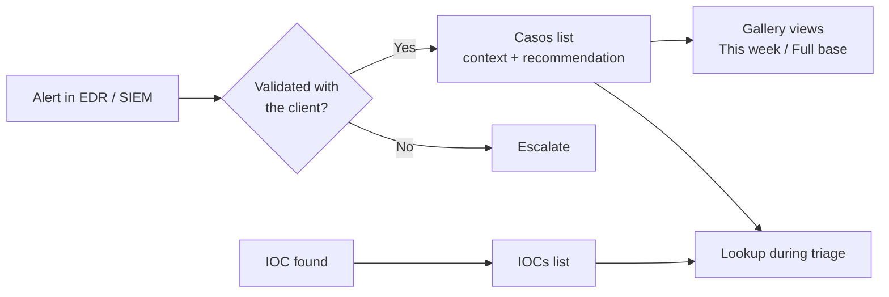

# Security Knowledge Base

SharePoint · Microsoft Lists · Power Automate · Excel

Structured knowledge base for a SOC: validated alert contexts and IOCs, organized in Microsoft Lists, with a data model designed to keep each record searchable, current and easy to act on.

---

## 🎯 Problem

IOCs and past investigations were buried in Excel files, hard to search and easy to lose. Analysts repeated work that had already been validated, and there was no clear way to know whether a finding was still current.

## 🛠️ What I built

- **Cleaned and standardized data:** one record per validated context, with fixed catalogs for technology, category, MITRE ATT&CK tactic and review status.
- **Structured Lists** in SharePoint, with a data model that separates the alert, the context and the recommendation.
- **Validity rules:** every record has a validity window, so expired context is visibly marked.
- **Gallery views** and status chips on top of the lists (see the companion project [ai-assisted-knowledge-management](https://github.com/Danivinho1/ai-assisted-knowledge-management)).
- **Weekly update workflow** with Power Automate (in progress).

## ✅ Outcome

Instant retrieval of known IOCs and validated alerts, and a model that scales from one week to a full history without losing context.

---

## Data model

Two main lists, plus a reference list for catalogs. Full definitions in [`docs/data-model.md`](docs/data-model.md).

| List | What it stores | Key fields |
|---|---|---|
| **Casos** | One validated alert context | Event, context title, incident, MITRE tactic, technology, category, recommendation, validity, review |
| **IOCs** | Indicators of compromise | Type, value, status, severity, related incident |
| **Listas** | Catalogs used by the choice columns | Technology, category, tactic, review, IOC status and severity |



## Repository structure

```
security-knowledge-base/
├── README.md
├── template/
│   └── Base_Conocimiento_Plantilla_FICTICIA.xlsx   Template with fictitious data
├── docs/
│   └── data-model.md                               Field definitions and rules
├── examples/
│   └── flujo-validacion.md                         How a context gets validated
└── CHANGELOG.md
```

## How to use the template

1. Open the Excel template to see the structure of each list.
2. In SharePoint, create a list with **+ New > List > From Excel** and upload a copy of the sheet.
3. Adjust column types as described in [`docs/data-model.md`](docs/data-model.md).
4. Replace the sample rows with your own data, and keep the sample file out of any shared location.

## Design decisions

- **Context and recommendation are separate fields.** Analysts read the recommendation first; the full context is for review.
- **Validity is a date, not a status.** A date keeps the record accurate over time and lets views hide what has expired.
- **Catalogs are fixed.** Choice columns prevent variants of the same value ("CrowdStrike" vs "CrowStrike"), which broke filters in the original spreadsheet.
- **IOCs and validated contexts are separate lists.** They have different lifecycles and different access needs.
- **No operational data in the repository.** The template uses documentation ranges and placeholder domains only.

## Sensitivity

Lists that contain IOCs or allow-listed activity should have stricter permissions than the rest of the site. Treat these lists as restricted information.

## Status and roadmap

- [x] Data model and template
- [x] Validity and review rules
- [ ] Power Automate: weekly summary and expiry reminders (in progress)
- [ ] Power BI dashboard for trends by technology and tactic

## License

[Pending: choose a license before publishing.]
